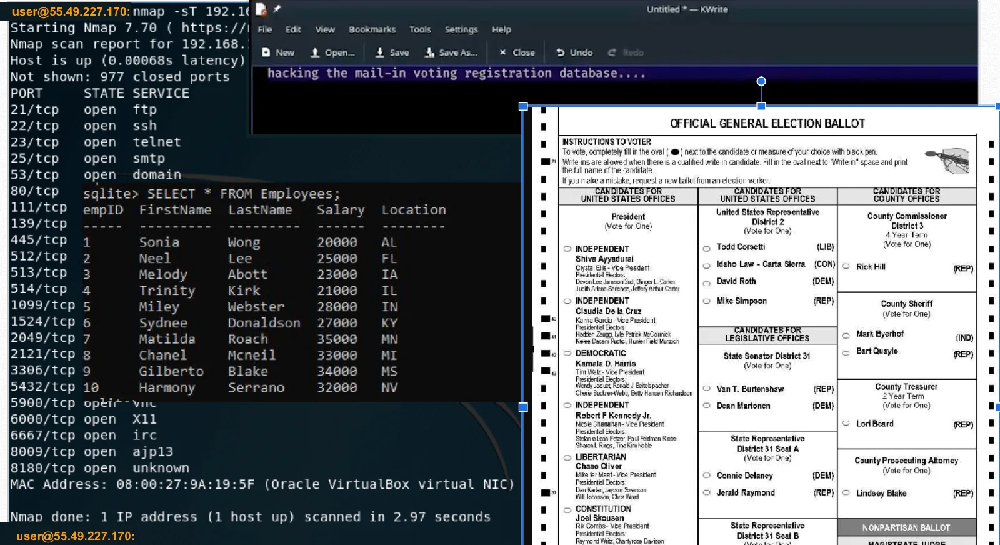

# KC7- Valdoria Votes : A Political Mystery (Pt 2)

#### About This investigation 
The Valdoria Board of Elections is gearing up for the most critical election in recent memory. To ensure a smooth voting experience, the board has hired additional poll workers in the past month, preparing them to support operations and assist voters. Officials have made it clear that the voting machines are highly secure, working tirelessly to reassure the public about the integrity of the election process.

However, malicious actors are actively working to sow doubt, hoping to make citizens question the validity of their vote. As Election Day approaches, Valdoria's citizens anxiously watch, wondering if democracy will withstand these challenges.

*Your mission: investigate the events leading up to this critical election. Analyze the data, uncover any hidden agendas, and help protect the integrity of Valdoria's vote.*

## User Account of interest
```
{
  "hire_date": "2024-09-19 00:00:00+00:00",
  "name": "Barry Schmelly",
  "user_agent": "Mozilla/5.0 (Windows NT 6.3) AppleWebKit/537.36 (KHTML, like Gecko) Chrome/86.0.4240.78 Safari/537.36",
  "ip_addr": "10.10.0.12",
  "email_addr": "barry_schmelly@valdoriavotes.gov",
  "username": "baschmelly",
  "role": "Temp Election Support Staff Supervisor",
  "hostname": "GCH3-DESKTOP",
  "mfa_enabled": "False",
  "company_domain": "valdoriavotes.gov"
}
```
```
{
  "hire_date": "2024-08-22 00:00:00+00:00",
  "name": "Anderson Snooper",
  "user_agent": "Mozilla/5.0 (Windows NT 5.1) AppleWebKit/537.36 (KHTML, like Gecko) Chrome/86.0.4240.99 Safari/537.36",
  "ip_addr": "10.10.0.4",
  "email_addr": "anderson_snooper@valdoriavotes.gov",
  "username": "ansnooper",
  "role": "Temp Election Support Staff Lead",
  "hostname": "NR5A-MACHINE",
  "mfa_enabled": "False",
  "company_domain": "valdoriavotes.gov"
}
```
```
{
  "hire_date": "2012-09-22 00:00:00+00:00",
  "name": "Arrack Bobama",
  "user_agent": "Mozilla/5.0 (compatible; MSIE 9.0; Windows NT 6.3; WOW64; Trident/5.0)",
  "ip_addr": "10.10.0.13",
  "email_addr": "arrack_bobama@valdoriavotes.gov",
  "username": "arbobama",
  "role": "Election Commissioner",
  "hostname": "QDPG-DESKTOP",
  "mfa_enabled": "False",
  "company_domain": "valdoriavotes.gov"
}
```

### To be Noted
- Mal-IP
   - 55.49.227.170
   - 214.85.104.248
   - 157.100.244.104

- Mal-Domains
   - valdoriavotesgov.com


#### Q 1: What is the name of the Deputy Commissioner?

```
Employees
| where role contains "Deputy Commissioner"
```
**Ans : Hilary Binton**

*very subtle KC7 :)*


#### Q 2: What is Dora Thomas' role?

```
Employees
| where name == "Dora Thomas"
```
**Ans : Polling Station Supervisor**


#### Q 3: What is this supervisor name?

```
Employees
| where role contains "supervisor"
```


**Ans : Barry Schmelly**

#### Q 4: What is Barry Schmelly IP address?

**Ans : 10.10.0.12**

#### Q 5: What is Barry Schmelly's hostname?

**Ans : GCH3-DESKTOP**

#### Q 6: What is Barry Schmelly's Email address?

**Ans : barry_schmelly@valdoriavotes.gov**

#### Q 7: How many emails did Barry Schmelly receive?


```
Email
| where reciepient == "barry_schmelly@valdoriavotes.gov"
```

**Ans : 37**


#### Q 8: How many distinct commands were run on Barry Schmelly's machine?
```
ProcessEvents
| where hostname == "GCH3-DESKTOP"
| distinct process_commandline
```

**Ans : 173**


#### Q 9: How many distinct URLs did employees with the first name William visit?

```
let the_willies=
Employees
| where name has "william"
| distinct ip_addr;
OutboundNetworkEvents
| where src_ip in (the_willies)
| distinct url
```
**Ans : 217**


#### Q 10: How many authentication attempts did we see to the accounts of employees with the first name William?

```
let the_willies2=
Employees
| where name has "william"
| distinct username;
AuthenticationEvents
| where username in (the_willies2)
```
**Ans : 183**


#### Q 11: Which table would tell us if Barry Schmelly received a suspicious email?

**Ans : Emails**


#### Q 12: Which table would tell us if he went to his bank website to see how much money he had?
 
**Ans : OutboundNetworkEvents** 


#### Q 13: Which table would tell us if Barry Schmelly saved a malicious file on his computer?

**Ans: FileCreationEvents**

#### Q 14: Which table would tell us if Barry Schmelly opened that malicious file that was saved on his computer?

**Ans : ProcessEvents**

#### Q 15 : Which table would you look in to see if that malicious file was detected on Barry Schmelly's machine?

**Ans : SecurityAlerts**

*The threat actor thought they were being slick, but in the poster, you can see they didn't practice good OPSEC and their IP was revealed to anyone reading it! 😂*




#### Q 15: What IP address did they forget to hide in the poster?

**Ans : 55.49.227.170**


#### Q 16: where there any inbound connection using this ip

```
InboundNetworkEvents
| where src_ip == "55.49.227.170"

AuthenticationEvents
| where src_ip == "55.49.227.170"
```

**Ans : No**


#### Q 17: How many domains resolved to the IP 55.49.**.***?

**Ans : 2**

```
PassiveDns
| where ip == "55.49.227.170"
```

*Whoa! One of them seems to be Valdoria related.*

*… but it doesn't look quite right.*


#### Q 18: What is the Valdoria related domain resolving to that IP?

**Ans : valdoriavotesgov.com**


#### Q 19: What is the legitimate domain for the Valdoria Elections Board?

*Ans : valdoriavotes.gov*


#### Q 20: How many IP addresses did the fraudulent Valdoria government domain resolve to?

```
PassiveDns
| where domain == "valdoriavotesgov.com"
```
**Ans : 3**


#### Q 21: Which table should we be looking at for records of that kind of activity again?

**Ans : inboundnetworkevents**

#### Q 22: How many requests do we see to our network from those IPs?

```
let mal_ip=
PassiveDns
| where domain == "valdoriavotesgov.com"
| distinct ip;
InboundNetworkEvents
| where src_ip in (mal_ip)
```

**Ans : 26**


*It looks like the actor started with researching employees at the Elections Board.*

#### Q 23: Which phase of the Cyber Kill Chain is this called?

**Ans : recon**

*In the first record we have of their activity, the hackers seemed focused on learning more about a certain group at the Valdoria Board of Elections.*

#### Q 24: What group were they specifically interested in?


**Ans : New hires**


and more 

*They left a pretty clear clue about their intentions by researching our ability to prevent malicious activity.*

#### Q 25: What specific area of our prevention measures were the threat actors interested in?

**Ans : Election interference**

#### Q 26: What important machines were the hackers trying to get into? (two words)?

**Ans : Voting Machines**

*The hackers even tried to locate a specific document that would reveal exactly how the machines operate.*

*With this information like configuration details or default passwords they could create a more effective plan to hack the machines.*

#### Q 27: Which document were the hackers looking for? (two words)*

 **Ans : technical manual**

 


*So we know they were targeting voting machines, but did they actually succeed?*

*Let’s look for evidence in our data. Remember, there was a suspicious-looking Valdoria domain registered by the adversaries.*

#### Q 28: Let’s check if there’s any traffic to it—has any of our employees visited that domain for any reason? (yes/no)

```
OutboundNetworkEvents
| where url contains "valdoriavotesgov.com"
```

**Ans : Yes**

*Deeep Deep sigh… This is not what we wanted to see at all.*

*Looks like there was traffic to that domain.*

#### Q29: When did someone first browse to that domain?(paste the full timestamp)

**Ans : 2024-10-07 10:46:45**


*The page appears to be some sort of login page…*

*Could it be a phishing page😱?*


#### Q30: Did anyone enter their credentials on that phishing page ? (yes/no)

**Ans : yes**


#### Q31: When did they enter their credentials into that page? (paste the full timestamp)


**Ans : 2024-10-07 10:46:47**

**What is the username of the employee that entered their credentials on that phishing page?**

**Ans : ansnooper**


#### Q32: What is the name of the employee who entered their credentials?

**Ans : Anderson Snooper**

#### Q33: What is Snooper's role?

**Ans :Temp Election Support Staff Lead**

#### Q34: Did Snooper have Multiple Factor Authentication enabled (yes/no)

**Ans : No**

*Ugh! Looks like someone didn't bother to follow the security guidelines! Thanks to that slip-up, the threat actor managed to log into Snooper's account.*

#### Q35: What table would we find this logon activity in?

**Ans : authenticationEvents**

#### Q36: When did the threat actor login to Snooper's account?
**Ans : 2024-10-07 15:46:45** 


*The threat actor managed to compromise Anderson Snooper's email account. Now, the question is: what did they do next?*

*Let’s investigate any suspicious activity coming from Snooper’s account after it was compromised.*

#### Q37: What is Anderson Snooper’s email address?

**Ans : anderson_snooper@valdoriavotes.gov**


*On October 8th, 'Snooper' had an interesting email conversation that’s worth investigating. Given the timing, it's likely that the threat actor was using his account after they compromised it.*
#### Q38: What is the email address of the person he was conversing with?

*Ans : barry_schmelly@valdoriavotes.gov*


*Err… okay. But what is so special about this Barry Schmelly individual?*

#### Q39:What is Schmelly's job role?

**Ans : Temp Election Support Staff Supervisor**


#### Q40: "Snooper" was observed asking Schmelly how one might gain access to what devices?

**Ans:voting machines**


*Schmelly claims he does not know how to access the devices.*
*However, 'Snooper' insists he needs them to accomplish a specific task.*
#### Q41: What is it? (four words)

**Ans : do my job though**

#### Q42: What system did Schmelly mention?

**Ans : AI system**


#### Q43: What is Snooper's IP address?

**Ans : 10.10.0.4**


#### Q44: What term appeared at the end of each url that Snooper guessed?

**Ans : model=gpt-4o**

#### Q45: What was the first subdomain that Snooper guessed?

**Ans :  Ai**


#### Q46: What status code was returned for Snooper's unsuccessful guesses?

**Ans : 404**


*After many failed guesses, it seems Snooper was getting desperate! One of the subdomains he tried was even related to a nursery rhyme.*

#### Q47: What was the nursery rhyme-related subdomain that Snooper guessed?

**Ans : ol-mcdonald-had-a-farm-ai-ai-oh**


#### Q48: What was the basketball player-related subdomain that Snooper guessed?

**Ans :allen-iverson**


#### Q49: What was the first subdomain "Snooper" guessed that returned a 200 status code?

**Ans :elections-chatbot**


#### Q50: How many questions did they ask the chatbot?

**Ans : 6**


#### Q51: Which conversation_id is associated with the question about voting machines?

```
AIPrompts
| where prompt contains "voting machines"
```
**Ans: 94bd6162-1323-402d-bccd-8fceaee5f230**


*Let's "pivot" on that conversation_id to see what else that user searched for.*

#### Q52: The AI bot told the threat actor to bring a _ and a banana.

**Ans : flashlight**

*According to the bot, the voting machines are not actually connected to the internet.*

#### Q53: Instead, votes are manually calculated using a ___.

**Ans : calculator**

*After trolling the threat actor for a bit, the AI chatbot suggests they might have better luck getting information about the voting machines from the vendor who makes them.*

#### Q54: What is the name of the vendor?

**Ans : Dominos Voting Systems**

#### Q55: What job role will the vendor talk to?

**Ans :  Election Commissioner**


#### Q56: What is the name of the employee with that job role?

**Ans : Arrack Bobama**


*Fortunately, the threat actors have not yet compromised Mr. Bobama.*

*That’s never stopped them before, though.*

*You advised Bobama to be cautious of any suspicious emails, making it less likely he’d fall for phishing attempts. However, a few days later, there was an unexpected password reset on Bobama's account. BUT HOW???*

*After investigating, we discovered that a call was made to the company helpdesk requesting a password reset.*

*We managed to capture a transcript of the call here:*


*Following the password reset, the threat actors logged into Bobama's account.*

#### Q57: When did they log in to Bobama's account?

```
AuthenticationEvents
| where username contains "bobama"
```

**Ans : 2024-10-16 00:00:00**

#### Q58: What IP address did the threat actors use to log in to that account?

**Ans : 214.85.104.248**


*The threat actors (using Bobama's account) were later observed sending an email to the voting machine vendor.*

#### Q59: What email address did they send this email to?
```
Email
| where sender contains "arrack_bobama@valdoriavotes.gov"
```
**Ans : help@dominosvotingsystems.com**

*In this conversation, the threat actors are once again informed that the voting machines can only be accessed physically, as they are not connected to the internet.*

### Q60: What PDF did the threat actors receive that might be useful to them later?

**Ans : ValdoriaVotingMachinesNetworkGuide.pdf**


*The threat actors tried repeatedly to hack the voting machines, but because they weren’t physically located in Valdoria near the machines, they couldn’t turn their network compromise into changes in the votes.*

*Instead, they decided to use the information they collected to create a fear-mongering video.*

*The votes are safe after all! Woo! Great job uncovering the truth.*
